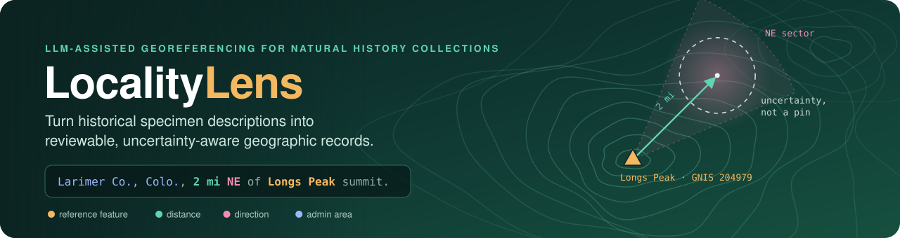
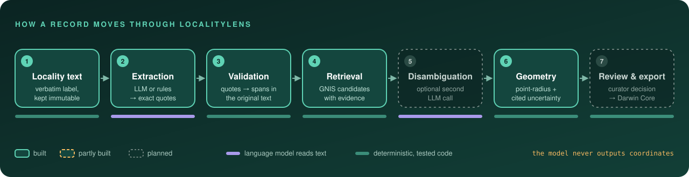
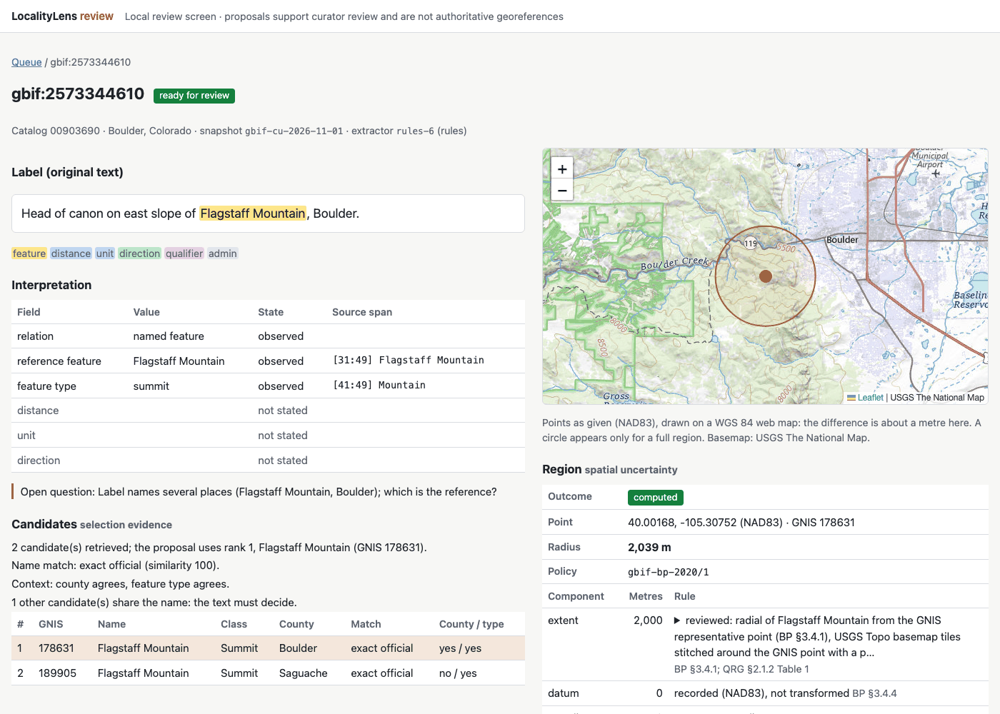

<p align="center">
  
</p>

<p align="center">
  <a href="https://github.com/professor3333/LocalityLens/actions/workflows/ci.yml"></a>
  
  <a href="https://github.com/astral-sh/uv"></a>
  <a href="https://github.com/astral-sh/ruff"></a>
  
  <a href="LICENSE"></a>
  <br>
  
  
  
  <a href="https://professor3333.github.io/LocalityLens/"></a>
</p>

<p align="center">
  <a href="#-how-it-works">How it works</a> ·
  <a href="#-try-it">Try it</a> ·
  <a href="https://professor3333.github.io/LocalityLens/">Replay demo</a> ·
  <a href="#-design-guarantees">Design guarantees</a> ·
  <a href="#-limitations">Limitations</a> ·
  <a href="#-roadmap">Roadmap</a> ·
  <a href="#-data--licences">Data</a> ·
  <a href="#-development">Development</a>
</p>

---

Natural history museums hold millions of specimens whose collecting locality exists only as prose
written by the collector, often a century ago:

> *Larimer Co., Colo., 2 mi NE of Longs Peak summit.*

Before ecologists can use such a record, someone has to read the abbreviations, find the right
reference place among many with similar names, apply the offset, and decide **how uncertain** the
result is. **LocalityLens** is a review workbench for that job. A small, local language model
*reads* the description. Ordinary, tested code finds the places and does the geometry. A
curator approves, corrects, or defers every result before it is exported as Darwin Core.

> [!NOTE]
> **Release v0.1.2: a research prototype, not a production georeferencing service.** This
> README separates what exists (✅) from what is planned (🔜). [Results on one page](docs/results.md). The first milestone has been measured on a locked test split
> three times, and every result is published below: the LLM alone fell short
> ([release 1](eval/reports/test-release-1.md)), and rules with an LLM fallback cleared the
> target by a thin margin, both with the first rules ([release 2](eval/reports/test-release-2.md))
> and with the current ones ([release 3](eval/reports/test-release-3.md)).

## 🧭 How it works

<p align="center">
  
</p>

The split between the stages is the core idea:

| The language model does | Deterministic code does |
|---|---|
| Read abbreviations and varied phrasing (`Colo.`, `Pk.`, `nr.`) | Look up places in a pinned gazetteer snapshot |
| Pull out relations: *what* is offset from *where*, by how much, in which direction | Parse every number and unit, and convert units exactly |
| Separate what the label **says** from what is **missing** | Compute coordinates and geodesic offsets on the source datum |
| Say which ambiguity a curator needs to resolve | Validate, track provenance, enforce statuses, export |

A **rules baseline** (regular expressions plus gazetteer name matching) fills the same contract.
It is the comparison system the LLM has to beat, and it runs through the identical validator
and retrieval, so any measured difference comes from language interpretation alone.

**The model never produces a coordinate, an ID, or a character offset.** It returns exact quotes.
Code locates those quotes in the original text, so every highlighted phrase in the review UI is
correct by construction, and an invented quote fails validation.

> 📘 **Cards:** [dataset card](docs/dataset_card.md) (sources, filtering, splits, annotation,
> limits) · [model card](docs/model_card.md) (pinned model, intended use, observed failure
> modes) · [evaluation](docs/evaluation.md) (correctness, metrics, protocol, results).

## ⚡ Try it

**Without installing anything:** the [static replay](https://professor3333.github.io/LocalityLens/)
is the real review screen, frozen after the release pipeline (hybrid-1) ran on the 50 audit
records. It is labelled as a replay on every page: nothing runs live, and decisions and export
are disabled. Those records are development data, so the replay shows how the screen works and
is not a measure of accuracy (see [demo/README.md](demo/README.md)).

**Locally.** Requirements, as measured on the development machine (Apple M1, 8 GB RAM):

| For | Needs |
|---|---|
| Rules baseline, gazetteer, review screen, export | Python 3.12+ and [uv](https://github.com/astral-sh/uv); about 30 MB of disk (GNIS snapshot 22 MB, gazetteer index 6.3 MB). No GPU, no network after the downloads |
| The LLM (Qwen3.5-4B Q4_K_M) | llama.cpp (build `b11960` pinned), 2.74 GB for the model file; llama-server uses 629 MB on top of the memory-mapped model. Warm latency p50 9.9 s, p95 16.4 s per call on the test |
| The lower-resource model (Qwen3.5-2B Q4_K_M) | 1.28 GB model file, about a quarter of 4B's model time on dev data; its process memory was not measured |
| The specimen snapshot (optional: only to re-run the audit, sampling or benchmark draw) | 157 MB for the Darwin Core Archive; no account |
| Docker (optional) | Docker Compose; see below |

```bash
git clone https://github.com/professor3333/LocalityLens.git && cd LocalityLens
uv sync
uv run localitylens data fetch-gnis                        # the pinned GNIS snapshot, ~23 MB, checksummed
uv run localitylens gazetteer build                        # SQLite index from that snapshot
uv run localitylens data fetch-gbif                        # optional: the pinned 165 MB specimen archive (DOI), checksummed
```

**The GNIS snapshot is pinned.** USGS serves only its current files, so `data fetch-gnis`
downloads the exact snapshot the release is built on (`gnis-co-2026-09-29`) from this
repository's [data release](https://github.com/professor3333/LocalityLens/releases/tag/data-gnis-co-2026-09-29)
(the original files, unchanged; USGS public domain), falls back to USGS, and checks every file
against the committed manifest. The reviewed extents and all results refer to this snapshot.
`data fetch-gnis --latest` gets the current USGS files instead, as a new snapshot with its own
manifest.

**The specimen snapshot is pinned the same way.** GBIF may erase the download file after
2027-05-01, so `data fetch-gbif` downloads GBIF's archive, unchanged, from this repository's
[data release](https://github.com/professor3333/LocalityLens/releases/tag/data-gbif-cu-2026-11-01)
(CC BY 4.0; cite *GBIF.org (01 November 2026) GBIF Occurrence Download
https://doi.org/10.15468/dl.hqxjjf*). It falls back to GBIF and keeps a file only if its
SHA-256 matches the committed manifest. No GBIF account is needed. `data fetch-gbif --request`
asks GBIF for a new download instead (account details `GBIF_USER`, `GBIF_PWD`, `GBIF_EMAIL` in
`.env`).

**Interpret a whole label** with the rules baseline: extraction, validation and retrieval in one
command. Every value carries its `[start, end)` span in the original text:

```console
$ uv run localitylens baseline run --limit 2 \
      "Larimer Co., Colo., 2 mi NE of Longs Peak summit."
extractor   rules-6
relation    distance_and_direction
quote       "2 mi NE of Longs Peak summit" [20:48]
feature     Longs Peak [31:41] type=summit
distance    2 mile [20:21]
direction   NE [25:27]
admin       county "Larimer Co." · state "Colo."
missing     none
retrieval   candidates_found (county context: Larimer Co., from text)
  1.  204979  Longs Peak                 Summit          Boulder      exact_official  type=y county=n
  2.  186722  Youngs Peak                Summit          Delta        fuzzy_official  type=y county=n
```

**Add a point-radius proposal** with `--propose`. Every uncertainty component is listed with
its rule. GNIS gives only a representative point for Longs Peak, so the extent is **unknown**,
not zero. The tool reports a lower bound and asks for the extent instead of drawing a falsely
small circle:

```console
$ uv run localitylens baseline run --limit 1 --propose \
      "Larimer Co., Colo., 2 mi NE of Longs Peak summit."
proposal    needs_information  [point-radius, policy gbif-bp-2020/1]
  point     40.27536, -105.58948 (NAD83)   feature 204979
  radius    unknown   (at least 1,657 m without extent)
    extent                   unknown  unknown
    datum                        0 m  recorded (NAD83), not transformed
    coordinate_source            0 m  gazetteer coordinate, no map measurement
    distance_precision         805 m  1-digit integer: precision 1 mile, half of it
    coordinate_precision        39 m  GNIS coordinates to the nearest second
    heading                  1,256 m  ±22.5° at 3,219 m (alone; combined geometrically)
  assume    'NE' read as bearing 45° ± 22.5° from true north (BP §3.4.5 Table 4; …)
  ask       What is the extent of Longs Peak (Summit)? GNIS gives only a representative …
```

With a reviewed extent (`--extent-m 500 --extent-note "…"`) the same record becomes
`computed` with a 2,018 m radius, and the extent's source and rationale are recorded.

**Reviewed extents live in a store**, [`data/reviewed/extents.csv`](data/reviewed/), one row
per GNIS feature, each a recorded map measurement with its method, source, who measured it
and the date. Pass
`--extents data/reviewed/extents.csv` to `baseline run`, `interpret` or the audit runs. Every
row is checked against the pinned snapshot first. Its 115 rows are the references of the dev and
validation annotations. 67 have been measured so far: 24 towns and 19 streams on USGS The
National Map, 11 summits and 9 gaps on the USGS Topo basemap, a glacier from USGS hydrography,
and 3 lakes on Google Maps. Towns and streams were checked against the USGS boundary polygon,
the NHD lines carrying the feature's GNIS ID, or the recorded end point.
Summit and gap edges are terrain judgments, checked against USGS 3DEP elevation profiles, and
each row says what it took as the edge:

```console
$ uv run localitylens extents check
extents-1: 67 reviewed, 48 pending, 0 problems
```

A reference with a measured extent gets a full region. Grand Lake's radius is its 1,300 m
measured extent plus 39 m of GNIS coordinate precision:

```console
$ uv run localitylens baseline run --limit 1 --propose --extents data/reviewed/extents.csv "Grand Lake."
proposal    computed  [point-radius, policy gbif-bp-2020/1]
  point     40.24357, -105.81465 (NAD83)   feature 204950
  radius    1,339 m
    extent                   1,300 m  reviewed: radial of Grand Lake from the GNIS representative …
    datum                        0 m  recorded (NAD83), not transformed
    coordinate_source            0 m  gazetteer coordinate, no map measurement
    coordinate_precision        39 m  GNIS coordinates to the nearest second
```

**Review and export.** Proposals go into a local review store (SQLite). Each record's original
text, its proposals and the curator's decisions are kept in separate tables. A curator
approves, edits then approves, rejects, or requests research. Only approved records are
exported, as Darwin Core CSV and as GeoJSON, and everything else goes into an unresolved report
that says what blocks it:

```console
$ uv run localitylens review import --sample eval/audit/audit-50.json --system rules \
      --extents data/reviewed/extents.csv
imported 50 records (rules)
  needs_information  38
  ready_for_review   9
  unsupported        3
$ uv run localitylens review queue --status ready_for_review
gbif:2573344610 ready_for_review   feature 178631, radius 2,039 m
gbif:2573415079 ready_for_review   feature 202381, radius 4,139 m
gbif:2573416221 ready_for_review   feature 170650, radius 1,342 m
gbif:2573446625 ready_for_review   feature 204798, radius 27,786 m
gbif:2573488436 ready_for_review   feature 177534, radius 1,639 m
gbif:2573528015 ready_for_review   feature 186534, radius 13,126 m
gbif:2573543074 ready_for_review   feature 204755, radius 1,029 m
gbif:2573548250 ready_for_review   feature 190391, radius 16,039 m
gbif:4052836581 ready_for_review   feature 204691, radius 8,426 m
9 records
$ uv run localitylens review decide gbif:2573441754 approve --reviewer <name> --rationale "…"
$ uv run localitylens review export
approved       1  -> data/review/export/occurrences.csv
geojson        1  -> data/review/export/occurrences.geojson
unresolved    40  -> data/review/export/unresolved.csv
```

**The selection check** (`selection-2`, on by default from v0.1.2) holds back a full region
when the label names another place that GNIS has inside the region, or one GNIS lacks. The
record goes to `needs_information` with the question, and approving it answers the question.
Two audit records are held this way:
- **gbif:2573367322** ("7 miles south of Boulder"): "the label also names 'Woman Creek' (in
  GNIS, inside the proposed region) … Is 'Boulder' the reference for the collecting place?"
  The annotation names a more specific place, so this full region is a wrong one, and the check
  catches it.
- **gbif:2573441754** ("Northern Gunnison Basin: ca 5 air mi SSW of Paonia"): the basin is not
  in GNIS. Here the offset from Paonia is the right reference, so the check costs a click.

The curator approved it above. The approved row is a point 5 miles SSW of the GNIS point,
`EPSG:4269`, uncertainty 2,957 m, with the GNIS feature and the measured extent named in
`georeferenceSources`. Review is still needed on ready records: gbif:2573416221 reaches GNIS
"Five Spring" from the label's "Five Springs" by a fuzzy match, which a curator should confirm.
`--no-selection` turns the check off. Across three declared checks on unread "place, offset"
labels it held back 53 wrong and 13 correct regions, and it passed two of the three
([test-5](eval/reports/test-5.md)).

**Import your own records** from a CSV with Darwin Core columns. Headers that are Darwin Core
terms map automatically (`dwc:` prefix and case don't matter); `--map COLUMN=TERM` maps the
rest. Required: an identifier (`occurrenceID`, `catalogNumber` or `gbifID`), `locality` and/or
`verbatimLocality` (the label as written is preferred and stored unchanged), `stateProvince`,
`county`, and `country` or `countryCode`. Coordinates and other answer-bearing columns are
never read. Every row is accepted or refused with a reason (no identifier, a repeated one, no
text, text over 4,000 characters, outside the scope, or withheld/generalized by the publisher),
and refusals go to a report. A test file of five audit records, one Utah record and one with
withheld information:

```console
$ uv run localitylens review import --csv mine.csv --system rules --extents data/reviewed/extents.csv
mine.csv: 7 rows, 5 accepted, 2 refused (snapshot csv-2ddf0c99d631)
  refused  screened out: outside_colorado: 1
  refused  screened out: sensitive_withheld: 1
  never read (answer-bearing): decimalLatitude
  refusals written to data/review/rejects-csv-2ddf0c99d631.csv
imported 5 records (rules)
  needs_information  4
  ready_for_review   1
```

The snapshot ID is a hash of the file, so every record points back to it. The same import
is `POST /api/imports` (a multipart upload): it returns each refused row with its reason and
queues the accepted records for the worker.

**Imports run through a persistent job queue** in the same SQLite file. A worker leases one
record at a time; if it crashes, the lease expires and the record goes back to `queued`, so an
interrupted import is resumed by `review work`. A model-server outage is retried (3 attempts);
deterministic failures, such as malformed output after the extractor's own retry, fail at once
with their category. Cancelling a batch leaves its unstarted records `queued`. Real output, from
an audit import interrupted after 20 records, cancelled, resumed, and then hit by a worker killed
while holding a lease:

```console
$ uv run localitylens review import --sample eval/audit/audit-50.json --system rules \
      --extents data/reviewed/extents.csv --no-process
imported 50 records (rules)
  queued; process with `localitylens review work`
$ uv run localitylens review work --extents data/reviewed/extents.csv --max-jobs 20
b-eee06dc4d4ce9984 (rules): needs_information 16, ready_for_review 4
$ uv run localitylens review cancel b-eee06dc4d4ce9984
b-eee06dc4d4ce9984: cancelled, 30 pending jobs stopped (records stay queued)
$ uv run localitylens review cancel b-eee06dc4d4ce9984 --resume
b-eee06dc4d4ce9984: resumed, 30 jobs pending again
$ uv run localitylens review work --extents data/reviewed/extents.csv   # after a worker was killed
lease expired: job 371d9cfcf844a15f, attempt 1
b-eee06dc4d4ce9984 (rules): needs_information 22, ready_for_review 5, unsupported 3
$ uv run localitylens review jobs
b-eee06dc4d4ce9984  active    rules  2026-11-10T15:53:04+00:00  done 50
1 batches
```

The final statuses (38 needing information, 9 ready, 3 unsupported) are the same as an
uninterrupted import's.

**Every attempt leaves a trace**: IDs, a SHA-256 of the model input, the versions (extractor,
release, gazetteer, uncertainty policy, validation), per-stage timings, the candidate count,
validation issue codes, model tokens and cache hits when an LLM was called, and the outcome.
The trace schema has no free-text field, so label text and coordinates cannot enter it (a
property test feeds it random labels). Traces are stored with the job step, can be written as
JSON lines (`--log-json`) or exported to OpenTelemetry as one span per attempt with a child
span per stage (`LOCALITYLENS_OTEL=console`, or `otlp` with `uv sync --extra otel` and the
standard `OTEL_EXPORTER_OTLP_*` settings), and the export names the trace behind each approved
record:

```console
$ uv run localitylens review import --sample eval/audit/audit-50.json --system rules \
      --extents data/reviewed/extents.csv --log-json data/review/traces.jsonl
$ uv run localitylens review traces
50 traces
  outcomes  needs_information 38, ready_for_review 9, unsupported 3
  rules    50 completed  p50 1.3 ms  p95 3.1 ms
  retries   0
```

**The review screen** shows the same store in a browser, on your own machine only:

```console
$ LOCALITYLENS_REVIEWER="<your name>" uv run localitylens review serve --extents data/reviewed/extents.csv
review screen on http://127.0.0.1:8000/  db data/review/review.sqlite  reviewer: <your name>
```

<p align="center">
  
</p>

- **Queue:** counts by status, a filter, and for each record its region or the question that
  blocks it, ready records first.
- **Record page:** the original label with every extracted value marked at its span; each
  field observed, missing or not stated; the retrieved candidates with the selection evidence;
  and the region with each uncertainty component and its rule. Selection evidence and spatial
  uncertainty are separate panels. The map draws a circle only for a full region.
- **Decisions** go through the same store: approve, edit then approve, reject or request
  research, each with a rationale. Approve is offered only when a retrieved candidate exists.
- **Export** from the queue writes the same Darwin Core CSV, GeoJSON and unresolved report as
  `review export`, and offers the three files for download.
- **A JSON API** on the same server (`/api`): batch status and a Server-Sent Events progress
  stream, cancel and resume, records, idempotent decisions (201 when created, 200 for a
  retry) and export. The worker stays a separate process (`review work`), so the API never
  waits on a model call. Real output while a worker ran:

  ```console
  $ curl -sN "http://127.0.0.1:8000/api/batches/b-eee06dc4d4ce9984/events"
  event: progress
  data: {"batch_id": "b-eee06dc4d4ce9984", "state": "active", …, "open": 50}
  event: progress
  data: {…, "jobs": {"done": 50}, "total": 50, "finished": 50, "open": 0}
  event: end
  $ curl -s -H "Content-Type: application/json" \
        -d '{"action":"approve","rationale":"Paonia as proposed"}' \
        http://127.0.0.1:8000/api/records/gbif:2573441754/decisions
  {"decision_id":"f0fbd481…","created":true,"status":"approved","edits":{},…}
  ```
- **Local only:** it binds to 127.0.0.1 and refuses other hosts, label text is always escaped,
  and cross-site posts are refused (API posts must also be JSON). HTMX and Leaflet are vendored, pinned copies; only the
  USGS map tiles need the network.

- **Approval needs a full region.** A curator can choose another retrieved candidate or give
  an extent (with a note on how it was measured). The proposal is then recomputed by the same
  code, and approval is refused if any question is still open.
- **Decisions are idempotent:** sending the same decision twice stores one.
- **Each decision records** the reviewer, the time, the rationale and the edits as a diff.
- **Edits are marked as human edits** in the export.
- **Export conventions:**
  - CSV: `geodeticDatum` is the source datum's EPSG code (`EPSG:4269`, NAD83), not transformed
  - `coordinateUncertaintyInMeters` is rounded up and never 0
  - `georeferenceVerificationStatus` is `verified by data custodian`
  - GeoJSON (RFC 7946) must be WGS 84, so its points are converted by one named operation:
    EPSG:1188, NAD83 to WGS 84 (1). It is a null transformation, so the numbers do not move, and
    EPSG states its accuracy as 4 m. Those 4 m are added to `coordinateUncertaintyInMeters`, so
    the GeoJSON circle is never smaller than the CSV's. The source point and datum stay in
    `localitylens_source_*` properties.
    - A better, grid-based route exists for Colorado (via NAD83(HARN)). Its grid is not
      installed and is not downloaded at runtime.
- **Not built yet:** footprint polygons (`footprintWKT` is empty in both files).

**When the label is ambiguous, it asks instead of guessing.** A bare `m` might be miles or metres:

```console
$ uv run localitylens baseline run "3 m E of Estes Park" --limit 2
relation    distance_and_direction
distance    3 (unit missing) [0:1]
direction   E [4:5]
missing     distance_unit
question    Does 'm' mean miles or metres?
retrieval   candidates_found
  1.  177636  Estes Park                 Flat            Larimer      exact_official  
  2.  204674  Estes Park                 Populated Place Larimer      exact_official  
```

**Route descriptions are flagged, not flattened** into a straight-line offset:

```console
$ uv run localitylens baseline run "5 mi up Big Thompson Canyon from Loveland"
relation    route_relative
quote       "5 mi up Big Thompson Canyon from Loveland" [0:41]
missing     route_geometry
```

### Run the local LLM

The model runs on your machine through llama.cpp. No API, no network at inference time. The
model, its quantisation, the prompt and the generation settings are pinned with checksums in
[`release/manifest.json`](release/manifest.json):

```bash
brew install llama.cpp                                     # or build llama.cpp from source
uv run localitylens model fetch                            # 2.74 GB GGUF, sha256-verified
llama-server -m models/Qwen3.5-4B-Q4_K_M.gguf \
  --host 127.0.0.1 --port 8080 -c 4096 -np 1 --no-context-shift
uv run localitylens model check                            # server matches the manifest
```

The same label, read by Qwen3.5-4B (prompt v2) instead of the rules. The output is checked the
same way: every quote is located in the text, every number is parsed by code, and there is no
field in which a coordinate could be returned. v2 keeps "summit" in the name. The gazetteer's
**core match** sets generic words aside, so "Longs Peak summit" still finds Longs Peak, one tier
below an exact match ([findings](eval/reports/retrieval-core-findings.md)):

```console
$ uv run localitylens interpret "Larimer Co., Colo., 2 mi NE of Longs Peak summit." --limit 2
extractor   llm-x2g2-qwen3.5-4b-q4km
relation    distance_and_direction
quote       "2 mi NE of Longs Peak summit" [20:48]
feature     Longs Peak summit [31:48] type=summit
distance    2 mile [20:21]
direction   NE [25:27]
admin       county "Larimer Co." · state "Colo."
missing     none
retrieval   candidates_found (county context: Larimer Co., from text)
  1.  204979  Longs Peak       Summit   Boulder   core_official    type=y county=n
```

<sub>Measured on an Apple M1 with 8 GB: llama-server's own footprint is 629 MB on top of the 2.74 GB
memory-mapped model file. The v2 prompt is about 2,350 tokens of the 4,096-token budget.</sub>

**Rules first, LLM as fallback** (`--system hybrid`). The rules answer whenever they reach the
gazetteer, with no model call. The LLM is asked only when they do not, and its answer is used
only if it reaches a candidate ([findings](eval/reports/hybrid-1-findings.md)):

```console
$ uv run localitylens interpret --system hybrid --limit 1 \
      "Larimer Co., Colo., 2 mi NE of Longs Peak summit."
system      hybrid-1: rules result used; no LLM call
extractor   rules-6
relation    distance_and_direction
quote       "2 mi NE of Longs Peak summit" [20:48]
feature     Longs Peak [31:41] type=summit
...
$ uv run localitylens interpret --system hybrid --limit 2 "Cirque of the Andrews Glacier"
system      hybrid-1: llm result used; LLM called
extractor   llm-x2g2-qwen3.5-4b-q4km
relation    named_feature
quote       "Cirque of the Andrews Glacier" [0:29]
feature     Andrews Glacier [14:29]
missing     none
retrieval   candidates_found
  1.  177848  Andrews Glacier            Glacier         Larimer      exact_official
```

The rules alone keep "Cirque of the" in the name and find nothing in GNIS.

**Batch runs are cached.** `audit llm` stores each completion under a key built from the exact
request (rendered prompt, schema, settings), the GGUF checksum and the running server's build.
A rerun with nothing changed makes no model calls: the audit, dev-1 and validation samples
rerun in 5–15 s each instead of several minutes, with identical results. Only greedy settings
are cached. A cached row reports 0 model seconds and is never counted as latency, and the
locked test split is never cached. Validation, retrieval and the uncertainty policy always run
again, so changing any of them needs no new model calls.

### Gazetteer search

**Abbreviated name, county from the label.** The right peak is found. GNIS files Longs Peak
under *Boulder* County, so the county disagreement is **shown as evidence, not used to discard
the match**:

```console
$ uv run localitylens gazetteer search "Long's Pk." --county "Larimer Co." --limit 2
  204979  Longs Peak                       Summit           Boulder      exact_official  sim=100.0 county=n state=y  (40.25486, -105.61624)
  186722  Youngs Peak                      Summit           Delta        fuzzy_official  sim= 85.7 county=n state=y  (38.71133, -107.60635)
```

**A former name on an old label.** Mount Evans was renamed Mount Blue Sky in 2023, and a
*different* peak in Park County is still officially "Mount Evans". Former names compete
equally with current ones, and context decides:

```console
$ uv run localitylens gazetteer search "Mt. Evans" --county "Clear Creek" --limit 2
  204716  Mount Blue Sky                   Summit           Clear Creek  exact_variant   sim=100.0 county=y state=y  (39.58812, -105.64373)
  179941  Mount Evans                      Summit           Park         exact_official  sim=100.0 county=n state=y  (39.25679, -106.18155)
```

**A place the gazetteer doesn't hold** is reported as absent. It is never guessed:

```console
$ uv run localitylens gazetteer search "Gold Hill Mine"
feature_absent_from_index
```

<sub>Some outputs are trimmed in width and length. The full output also shows state/type flags and the GNIS representative point (NAD83), which is evidence, not a georeference.</sub>

### Run it with Docker Compose

One image holds the review screen, the JSON API and the worker; an optional profile adds
llama-server for LLM and hybrid imports. Everything listens on the host's 127.0.0.1 only, and
`./data` (snapshots, gazetteer, review store, reviewed extents) is mounted, never baked in.

```bash
docker compose build
docker compose run --rm review data fetch-gnis                    # once: the pinned GNIS snapshot
docker compose run --rm review gazetteer build
docker compose up -d                                              # screen + worker
docker compose run --rm review review import --sample eval/audit/audit-50.json --system rules \
    --db /app/data/review/review.sqlite --index /app/data/derived/gazetteer.sqlite \
    --extents /app/data/reviewed/extents.csv --no-process         # the worker picks it up
docker compose --profile llm up -d                                # also llama-server (needs ./models)
```

`/readyz` answers 503 until the review store exists and `release/manifest.json` matches the
code, and reports every pinned version (model and revision, GGUF SHA-256, llama.cpp build,
prompt, schema and policy versions, snapshots, store and API versions). Checked with the audit
sample: the containerized worker processed all 50 records (38 needing information, 9 ready,
3 unsupported, as on the host), and stopped cleanly on SIGTERM:

```console
$ curl -s http://127.0.0.1:8000/readyz | jq -c '{ready, release: .release.release, model: .release.model.id, llama_cpp: .release.llama_cpp.build, store: .store_schema}'
{"ready":true,"release":"0.1.2","model":"Qwen/Qwen3.5-4B","llama_cpp":"b11960-8642541b2","store":"review-3"}
```

- **llama-server never gets a network address:** it shares the worker's network namespace and
  keeps the manifest's `--host 127.0.0.1`.
- **The `llm` profile runs, but slowly on a small machine.** On the 8 GB M1 (Docker Desktop, 4 GB
  VM, CPU only) one hybrid record took 540 s, against about 10 s for native llama-server with
  Metal. Run llama-server natively there. Raise the worker's job lease with `LOCALITYLENS_LEASE`
  (default 300 s) on hosts where a call can take longer.
- **On Linux,** run as your own user so the container can write `./data`:
  `LOCALITYLENS_UID=$(id -u) LOCALITYLENS_GID=$(id -g) docker compose up -d`.
- Images are pinned by digest: Python 3.12 slim, uv 0.12.5, llama.cpp `server-b11960`.

**Backup, upgrade and rollback** are in [docs/deployment.md](docs/deployment.md). The review
store is the only state that cannot be rebuilt: `review backup` copies it safely while
everything runs, and `review restore` puts a backup back after a rollback, keeping the replaced
store. A rollback was rehearsed on a fresh clone, natively and in Docker Compose.

## 🛡️ Design guarantees

| Guarantee | How it is enforced today | |
|---|---|:-:|
| **The LLM never produces coordinates** | The output schema has no coordinate field and rejects unknown ones, free-text questions are scanned for coordinates, and the model server is loopback-only with no tools. Coordinates come only from `localitylens.geo` | ✅ |
| **Every claim cites the label** | Quotes must be found in the text and are mapped to half-open `[start, end)` spans of the *original* string | ✅ |
| **Swapped or invented details are caught** | Code re-parses quoted directions and units and rejects mismatches. A bare `m` (miles or metres?) cannot be asserted | ✅ |
| **Missing ≠ zero** | Each relation's parts must be present or explicitly declared missing. GNIS `0.0` coordinates are stored as null | ✅ |
| **Context ranks, never filters** | County, state and feature type order the candidates, and each candidate carries its evidence | ✅ |
| **Abstain rather than guess** | A bare `m` becomes "unit missing" plus a question. "Hwy 34" is not a distance. Route descriptions are labelled, not flattened. A name the gazetteer lacks is reported absent, not trimmed to a lookalike | ✅ |
| **Humans approve before export** | A single checked status machine. Only `approved` records are exportable | ✅ |
| **A crash never strands a record** | Each job step is one SQLite transaction that moves the job and its record together. Expired leases return records to `queued`; a late result from a lost lease is discarded; 5,000 random interleavings of claims, crashes, retries, cancels and resumes keep every record in a defined state | ✅ |
| **No label text in telemetry** | Traces carry only IDs, hashes, versions, counts, timings and codes: the schema rejects prose and unknown fields, and property tests check that random labels and candidate coordinates never appear | ✅ |
| **Label text stays data on screen** | The review screen binds to loopback only, autoescapes every label, refuses cross-site form posts, and makes no model calls | ✅ |
| **A point is not a place** | Without a reviewed extent (or a published default such as a spring's 3 m), the radius stays unknown. The proposal reports a lower bound and asks for the extent | ✅ |
| **Extents are measured, never guessed** | Each extent records its method, source, who measured it and the date, is checked against the snapshot's name and point, and is pinned by hash in every report that uses it | ✅ |
| **Every uncertainty number is cited** | Each component carries its rule and its source: GBIF Best Practices, the Quick Reference Guide, or the Georeferencing Calculator's reference code | ✅ |
| **Reproducible provenance** | Checksummed, immutable source snapshots. The index records which snapshot built it | ✅ |
| **No answer leakage** | Coordinate and georeference columns are never read from the archive. A model sees only an allowlist: label text, state, county, country | ✅ |

<details>
<summary><b>Uncertainty policy <code>gbif-bp-2020/1</code>: rules and sources</b></summary>

| Component | Rule | Source |
|---|---|---|
| Heading | N/E/S/W ±45° · NE/SE/SW/NW ±22.5° · NNE-type ±11.25°, true north | Best Practices §3.4.5 Table 4 |
| Distance precision | Fractions: half of 1/denominator. Decimals: exact halves, quarters or eighths, else tenths or hundredths. Integers: half of 10^max(0, digits−2) | Best Practices §3.4.6; every row of Table 5 is a test |
| Distance + heading | `√((d+dp−d·cos α)² + (d·sin α)²) + coordinate precision`, where `dp` sums datum, extent and distance precision | Georeferencing Calculator `calculateMaxErrorDistance` |
| Named place, distance only | Linear sum of components (plus the offset, for distance only) | Georeferencing Calculator |
| Coordinate precision | GNIS is recorded to the nearest second: precision × √(lat m/° ² + lon m/° ²) | Georeferencing Calculator `getCoordPrecisionError` |
| Datum | Recorded (NAD83) and not transformed → 0. Unknown → 5,359 m | Best Practices §3.4.4 |
| Extent | Reviewed value, or a published default (spring 3 m). Otherwise **unknown** | Best Practices §3.4.1 · Quick Reference Guide Table 1 |
| "about", "ca." | No effect on coordinates or uncertainty | Best Practices §2.2 |
| "near", "vicinity" | No defensible default, so the record needs information | Quick Reference Guide §2.1.3.8 |
| Heading without distance | Unbounded, so the record needs information | Quick Reference Guide §2.2.2 |

Tests reproduce the published examples exactly: 10 km NE → 3.90 km (§3.4.5), a ¼° grid cell at
the equator → 39,226 m (Quick Reference Guide Table 1), and all 14 rows of Table 5.

</details>

## 🔬 Feasibility audit

The first milestone is decided on real labels, not synthetic ones. Every record in the snapshot
is accounted for:

```text
311,988  GBIF records (CU Herbarium, DOI 10.15468/dl.hqxjjf)
206,444    excluded, each with a reason (other state, no state, withheld, ...)
105,544  eligible: Colorado, not withheld, real locality text
 40,444  distinct locality groups (same wording, same county)
     50  audit sample: seeded, one record per group → eval/audit/
```

Both systems have run on the sample: the rules baseline
([report](eval/reports/audit-50-rules-1.md), [findings](eval/reports/audit-50-rules-1-findings.md))
and Qwen3.5-4B ([report](eval/reports/audit-50-llm-x1g2-qwen3.5-4b-q4km.md),
[findings](eval/reports/audit-50-llm-x1g2-qwen3.5-4b-q4km-findings.md)), then both were scored
against a blind annotation of every record ([worksheet](eval/audit/worksheet.csv),
[scores](eval/reports/audit-50-score.md)).

> **Answer: yes for rules with an LLM fallback, no for the LLM alone.** Both were scored on
> the 120-record **locked test**, each under a declaration pushed before its run. The LLM
> alone gives **15 of 56** correct proposal candidates against the rules' **19** (release 1,
> −7 points). `hybrid-1` runs the rules and calls the LLM only where they reach no gazetteer
> candidate. It gives **25 of 56: +10.7 points** (95% CI +3.6 to +19.6, p = 0.031), just over
> the +10 point target ([release 2](eval/reports/test-release-2.md)). With the current rules
> (rules-6) both gain 3: **hybrid-1 28 against rules 22 of 56, +10.7 points again** (same CI,
> 6 gained, 0 lost; [release 3](eval/reports/test-release-3.md)).

| Correct proposal candidates | Rules | LLM v2 alone | **hybrid-1** |
|---|---|---|---|
| **Locked test, release 3** (rules-6; 56 answerable) | 22 (39%) | 18 (32%) | **28 (50%)** |
| Locked test, releases 1–2 (rules-1) | 19 (34%) | 15 (27%) | 25 (45%) |
| test-2, fresh sample (Claude-annotated, not independent; 80 answerable) | 34 (43%) | 31 (39%) | 43 (54%) |
| Validation (held out, now read; 32) | 13 (41%) | 15 (47%) | 16 (50%) |
| Audit (dev data; 31) | 14 (45%) | 12 (39%) | 14 (45%) |
| dev-1 (v2 was written on it; 29) | 16 (55%) | 18 (62%) | 18 (62%) |

**Against GEOLocate** (read samples, plan pinned before any query; [findings](eval/reports/geolocate-findings.md)):
points within 5 km of the position each annotation supports. On the owner-annotated samples:
GEOLocate 58, rules 54, LLM 59, hybrid-1 61 of 85. GEOLocate gives a point for 82 of the 85,
but more of its points are wrong; ours abstain more often. Positions come from GNIS, which favours
our systems at short distances.

The rows below the test are the release-2 configuration; the rules changes that follow led to
release 3.

**Since release 2: rules-2.** The rules now read "air mi", spelled-out numbers before a unit
and a bare "ca" ([findings](eval/reports/rules-2-findings.md)). On the audit they gain 3
records (14 → 17), and hybrid-1 also goes 14 → 17. These gains are in-sample, since the fixed
labels came from the audit findings. dev-1 and validation are unchanged, and no record got
worse. The locked test has not been scored with rules-2.

**Then rules-3.** It fixes the two errors behind the incorrect regions
([findings](eval/reports/rules-3-findings.md)):
- **Spaced directions:** "10 mi. n. w. Salida" is no longer cut to "10 mi. n".
- **The collecting place:** a named place written right before an offset is read as where the
  specimen was collected, when a position word puts it there ("S. slope of Thunder Mt.,
  16 miles N of Grand Lake") or the label opens with it and the offset is at least a mile
  ("Vernal Mesa, 15 mi. east of Montrose").

On these samples, correct candidates rise from 46 to 50 for the rules and from 51 to 55 for
hybrid-1, and no record gets worse. The gains are in-sample, because the rule was written
knowing these labels.

**Then rules-4.** rules-3 also let a broad feature replace a precise offset: "Arkansas River,
5 mi E of Salida" became a 1,500 km circle. Streams, ranges, parks and forests now keep the
offset ([findings](eval/reports/rules-4-findings.md)). No score changes on these samples, because
none of them has such a label, but 360 of the 1,323 unread groups where rules-3 replaced an offset
go back to it.

**Then rules-5.** A distance range ("ca 20-21 air mi") was read as its second number, a silent
false precision. Ranges are now asked about: the distance is missing and an open question names
the range ([findings](eval/reports/rules-5-findings.md)). On the read samples only A23 changes
(now correct, in-sample: rules 50 → 51, hybrid-1 55 → 56 of 92). On 38,272 unread groups,
217 ranges read as one number now ask instead. rules-6 adds "2 or 3 mi" ranges, which rules-5
still read as one number; no read or unread label outside dev-3 and the held-out groups changes
([findings](eval/reports/rules-6-findings.md)).

**On fresh data: dev-2.** 50 new groups were annotated by Claude, at the owner's request, and
then scored once by a plan pushed before any system ran ([plan](eval/dev/dev-2/scoring-plan.md),
[findings](eval/reports/dev-2-findings.md)). Correct candidates of 36 answerable:

| rules-4 | LLM v2 | hybrid-1 |
|---|---|---|
| 19 (53%) | 17 (47%) | **21 (58%)** |

- **The overall picture holds on unseen labels.** hybrid-1 leads the rules by 2 records (CI +0
  to +14 points) and is never behind, and the LLM alone is not better than the rules. The rates
  are close to the in-sample rates, so there is no sign the rules were overfitted.
- **This is weaker evidence than the owner's blind sets.** Claude also wrote the rules, so the
  annotations are not independent of them, and the comparison may lean toward the rules.
- **rules-3 and rules-4 are still untested.** Only 3 dev-2 labels have a place right before an
  offset. rules-4 changes no reading, and rules-3 changes one (E29) and no score.
- **One label is a repeat:** E40, "Hoosier Pass.", has the same text as validation's V021,
  under a different county. Without it: 18 / 16 / 20 of 35. No locked-test text repeats a read
  one.

**Next on fresh data: dev-3.** 50 more groups, 35 of them "place, offset" labels (a clause, then
an offset such as "Vernal Mesa, 15 mi. E of Montrose"), the case rules-3 and rules-4 decide.
Samples now also skip any label whose wording repeats a read or held-out one under another
county ([how it was drawn](eval/dev/README.md#dev-3)). Claude annotated it, so, as with dev-2,
it is not an independent check of rules Claude wrote. Scored once by a plan pushed first
([plan](eval/dev/dev-3/scoring-plan.md), [findings](eval/reports/dev-3-findings.md)), correct
candidates of 32 answerable:

| rules-6 | LLM v2 | hybrid-1 |
|---|---|---|
| 11 (34%) | 14 (44%) | **14 (44%)** |

- **hybrid-1 again leads the rules** (+3, CI +0 to +22 points, never behind), on harder labels
  than dev-2.
- **The place-or-offset rules show no gain.** Replaying rules-2 to rules-6 on the 24 answerable
  place-offset records: 6, 7, 6, 6, 6 correct. rules-3 finds the place in two labels, takes a
  broad region over the offset in one, and cuts a place at a sentence break in another; rules-4
  then reverts one of rules-3's gains. The in-sample gains (rules 46 → 50) did not carry over.
- **No full region is correct:** the 2 computed regions come from wrong readings.

**dev-4,** 50 more groups with 35 "place, offset" labels. It was drawn for the owner to annotate;
the owner then had Claude annotate it, so it is the same weak kind of evidence as dev-3. Scored
once by a plan pushed first ([plan](eval/dev/dev-4/scoring-plan.md),
[findings](eval/reports/dev-4-findings.md)), correct candidates of 29 answerable: rules-6 9,
**LLM 14**, hybrid-1 10.

- **The place-or-offset rules lose ground again:** rules-2 to rules-6 give 6, 6, 5, 5, 5 of 22
  place-offset records. Over dev-3 and dev-4 they gain 2 and lose 3.
- **The LLM reads those labels better,** and rules-first hybrid-1 never asks it when the rules
  reach any candidate (6 such records here). Over dev-2 to dev-4 the LLM and hybrid-1 tie at 45
  of 97, against 39 for the rules.
- **All 3 full regions are wrong** (offsets from Boulder and Grand Lake).

**A smaller model, Qwen3.5-2B,** is about 4× faster but misquotes labels: 51 of 160 extractions
fail validation. On dev and validation data it gives 27 correct candidates of 92 on its own,
against 46 for 4B. As hybrid-1's fallback it still reaches 49 against 4B's 51
([findings](eval/reports/qwen3.5-2b-findings.md)).

**Full regions, with 67 measured extents and rules-6** (findings for
[extents](eval/reports/extents-findings.md), [batch 4](eval/reports/extents-batch-4-findings.md),
[rules-3](eval/reports/rules-3-findings.md), [rules-4](eval/reports/rules-4-findings.md) and
[rules-5](eval/reports/rules-5-findings.md)):

| | Rules `rules-6` | LLM | **Hybrid `hybrid-1`** | Target |
|---|---|---|---|---|
| *Read samples (audit, dev-1, validation: 92 answerable)* | | | | |
| Regions computed | 32 | 33 | **35** | |
| … correct (precision) | 29 (91%) | 28 (85%) | **32 (91%)** | ≥ 95% |
| Useful coverage | 29 (32%) | 28 (30%) | **32 (35%)** | ≥ 70% |
| *dev-2, unseen labels (36 answerable)* | | | | |
| Regions computed | 10 | 8 | **11** | |
| … correct (precision) | 9 (90%) | 7 (88%) | **10 (91%)** | ≥ 95% |
| Useful coverage | 9 (25%) | 7 (19%) | **10 (28%)** | ≥ 70% |

- **Unseen labels behave like the read ones.** dev-2's 12 new extents took its regions from 2
  to 11, 10 of them correct (median correct radius 3.2 km).
- **More extents expose reading errors.** Every incorrect region that batch 4 added was already
  a wrong reading that used to stop at `needs_information`: an offset from Boulder chosen over
  the place named later (Rocky Flats ×2, Bluebell Canyon), and a range, "20-21 air mi", that the
  rules read as exactly 21 mi. rules-5 fixes the range. A recheck then sent Mount Shavano back
  to pending (no defensible edge), which removes one correct region (V013). Precision on the
  read samples is 91% (97% before batch 4). The target needs better readings, not more extents.
- **What blocks the rest:** extents with no defensible edge (towns with no mapped limit, long
  slopes, canyon passes) and direction-only labels with no distance.
- **"Correct" tests the interpretation and the reference,** not the size of the radius: one
  correct dev-2 region is 39 km.

> [!WARNING]
> **The 91% above is inflated by how extents were chosen.** Extents were measured only for the
> features the annotations accepted, so a wrong pick could never get a region.
> [Derived extents](data/extents/README.md) give every feature with a Census place polygon or an
> NHD geometry a region (11,993 features, computed from the pinned snapshots; opt-in with
> `--derived-extents`). With them, hybrid-1's regions are 52 of which 33 are correct (63%) on the
> owner-annotated read samples. On Claude-annotated dev-3 and dev-4, mostly unmeasured features,
> they are 36 of which 14 are correct (39%), with useful coverage 0 → 23%
> ([findings](eval/reports/derived-extents-findings.md)). The derived extents match hand
> measurements (median ratio 0.98 over 45 features). What fails is choosing the reference: a
> specific collecting place is named and missed, and "N mi of Town" wins.

**How to read the "yes":**
- **The margin is one record.** +10 points of 56 is 5.6 records, and the hybrid gains 6 while
  losing none.
- **The interval includes gains below 10 points.** It shows the hybrid beats the rules, not
  that the true gain is at least 10.
- **The test was scored twice.** The hybrid idea came partly from release 1's totals, though
  its rule was chosen on dev data only ([findings](eval/reports/hybrid-1-findings.md)).
- **The gain is retrieval.** The LLM reaches a gazetteer entry for names the rules can't
  parse: top-1 acceptable 33 of 56 against 25. It calls the model on 39% of records.
- **Proposals are measured on dev and validation data only.** The locked test has no
  measured extents, so the target's "comparable precision" can't be checked there (see below).

<sub>Release 1, LLM alone: retrieval is level on the test (an acceptable reference ranked first
in 25 of 56 for both). The LLM loses on interpretation: direction-only labels (0 of 7 against 5), qualifiers (71%
against 86% right) and 15 of 120 outputs rejected by validation. It flags more unsupported
labels (9 against 7 of 16) and more references absent from GNIS (26 against 17 of 48). LLM
latency p50 11.7 s, p95 20.9 s per record (Apple M1, 8 GB). Release 2, hybrid-1: it keeps the
rules' direction-only, qualifier and validity results, but reports fewer references absent
from GNIS (14 against 17 of 48), and model time is 39% of the LLM alone.</sub>

<details>
<summary><b>The audit in detail</b> (dev data, prompt v1 and v2)</summary>

| Scored against annotations | Rules | LLM v1 | LLM v2 |
|---|---|---|---|
| **Correct proposal candidates, with core retrieval** (of 31 answerable) | **14 (45%)** | – | **12 (39%)** |
| Correct proposal candidates, before core retrieval | 13 (42%) | 9 (29%) | 10 (32%) |
| Relation read correctly (of 50) | 26 (52%) | 30 (60%) | 30 (60%) |
| Critical interpretation exact (of 50) | 24 (48%) | 20 (40%) | 22 (44%) |
| Acceptable reference ranked first (of 31) | 16 (52%) | 11 (36%) | 12 (39%) |
| Distance-and-direction labels right (of 9 answerable) | 5 | 7 | 6 |
| Named-place labels right (of 20 answerable) | 7 | 2 | 4 |
| Place names read as "no locality" | 0 | 7 | 1 |
| Unsupported labels flagged unsupported (of 4) | 0 | 4 | 4 |
| Mean fields a curator must correct per record | 1.88 | 2.08 | 1.82 |

<sub>A correct proposal candidate becomes a correct proposal once the feature extent is supplied.
Rows other than the first two are before core retrieval. Excluding the 10 rows the annotator
marked unsure, with core retrieval: rules 12/24, v2 10/24. v2 against the rules: −7 points
(95% CI −26 to +13, p = 0.75). The audit records are
dev data and too few for the final comparison, which uses the locked benchmark.</sub>

</details>

<details>
<summary><b>System outcomes before scoring</b></summary>

| On 50 real labels | Rules `rules-1` | LLM `llm-x1g2` (Qwen3.5-4B Q4_K_M) |
|---|---|---|
| Relation read | named feature 22 · distance + direction 14 · direction only 10 · other 2 · distance only 1 · route 1 | distance + direction 24 · named feature 13 · no locality 7 · route 5 · itinerary 1 |
| Rejected by validation | 0 | 9 (inexact quotes, contradictions, unparseable numbers) |
| Retrieval | candidates found 33 · absent from GNIS 14 · no reference 3 | candidates found 22 · absent from GNIS 12 · no reference 7 |
| Proposal | needs information 46 · unsupported 3 · computed 1 | needs information 27 · unsupported 13 · computed 1 |
| Time per record | milliseconds | p50 10.2 s · p95 14.7 s (Apple M1, 8 GB) |

</details>

<details>
<summary><b>What the audit already shows</b></summary>

- **Real labels are multi-clause.** Many chain a forest, a range, a road and an offset in one
  string. The rules read one clause, and not always the most specific one.
- **Unknown extent is the main blocker.** Most references are towns, summits and streams with a
  single GNIS point, so honest proposals ask for an extent. With 67 of the store's 115 rows
  measured, 11 audit records get a full region under the rules (9 of them correct).
- **Rules gaps with names:** "air mi", spelled-out numbers, ranges, road designations read as
  places, and leading words ("Above", "Near") absorbed into names. rules-2 fixes "air mi" and
  spelled-out numbers. rules-3 fixes spaced directions ("n. w.") and prefers a named collecting
  place written before an offset, rules-4 keeps the offset when that place is broad, and rules-5
  asks about distance ranges instead of reading their second number.
- **The LLM reads what the rules miss, and makes its own errors:** it handles "air mi",
  separates "Above"/"Near" from names and flags more route descriptions. It also called 7 labels
  that name a place "no locality", and 9 of its outputs were rejected by validation (as designed).
- **A grammar lesson:** the first LLM run failed 5 times because the decoding grammar allowed
  combinations that validation rejects, and greedy retries repeat themselves. The grammar now
  admits only valid combinations. The failed run is [kept](eval/reports/audit-50-llm-x1-qwen3.5-4b-q4km.md).
- **Prompt v2 was built on fresh records.** A stratified dev sample, [`dev-1`](eval/dev/),
  over-represents the failing label shapes, so the audit stays a check. Every group read in
  development is recorded in [`eval/viewed-groups.json`](eval/viewed-groups.json) and excluded
  from any held-out split. v2 fixed the "no locality" error but barely moved the audit score.
- **Retrieval was the bottleneck.** A core-match tier now sets generic words aside ("Mt.
  Zenobia" finds GNIS "Zenobia Peak"; "Lower Piney Lake" finds "Piney Lake" but never "Upper
  Piney Lake"). It fixed the 2 audit records it was designed from, for both systems, and changed
  nothing on dev-1: no regressions, but no out-of-sample evidence yet.
- **A benchmark nobody had read.** Validation (60) and a locked test (120) are drawn from
  groups untouched by development, grouped by collecting event so that no trip spans two
  splits ([how](eval/benchmark/)).
- **On validation the LLM led, narrowly.** It picks the right reference more often (top-1 18
  vs 15 of 32) but reads relations no better (critical interpretation 23 vs 25 of 60). The most
  common shared miss is the one prompt v2 targeted: "Vernal Mesa, 15 mi. east of Montrose" read
  as an offset from Montrose instead of as Vernal Mesa (5 records).
- **On the locked test it did not.** The lead seen on validation reversed to −7 points on 120
  unseen records, which is why the milestone is decided on the locked split and not on
  validation.
- **Supplied counties are not always counties.** 2,710 eligible records carry `Unknown`,
  `Unknown-E` or two counties (`Gunnison/Pitkin`). Retrieval now treats placeholders as
  missing, so the label's own county is used, and lets a two-county value match either county
  ([findings](eval/reports/county-context-findings.md)). This changed no result on the dev or
  validation samples.

</details>

## ⚠️ Limitations

- **One herbarium, Colorado, English.** Every number here comes from University of Colorado
  Herbarium labels. Nothing is claimed for other collections, regions, languages or OCR text.
- **Small, thin margins.** The locked test has 56 answerable records; one record is 1.8 points.
  hybrid-1 cleared the +10 point target by the smallest possible margin, and its interval
  (+4 to +20) does not rule out a smaller true gain.
- **Repeated text.** Grouping removes identical wordings and shared collecting events before
  splitting, but different wordings of the same place can still fall in different splits.
- **One annotator per set.** The owner annotated the audit, dev-1, validation and test; Claude
  annotated dev-2 to dev-4, and also wrote the rules they check. There is no second reviewer
  and no self-consistency pass yet.
- **GNIS is current; labels are historical.** Old names, vanished places and changed counties may
  be missing or misleading. Mines and other cultural features without a GNIS class cannot be
  matched.
- **GNIS gives points, not shapes.** A region is computed only when the feature's extent has been
  measured (67 of 115 dev and validation references so far); otherwise the record asks for it.
- **Existing specimen coordinates are not ground truth** and are not used.
- **Route-relative, itinerary and multi-leg descriptions are out of scope.** They are reported
  as unsupported, with the evidence that would make them supportable.
- **No proposal does not mean unlocatable.** `needs_information` and `unsupported` mean this
  release could not propose a region, not that a curator cannot.
- **Not measured yet:** regions on the locked test, containment with region size, reviewer time,
  GEOLocate on held-out data, and the second model call. See
  [evaluation](docs/evaluation.md#not-measured-yet).

## 🗺️ Roadmap

| Phase | Scope | Status |
|---|---|---|
| **1 · Data & feasibility** | ✅ core contract & validation · ✅ GNIS gazetteer · ✅ rules baseline · ✅ uncertainty policy · ✅ specimen snapshot (DOI) · ✅ ingest & screening · ✅ 50-record audit, scored: rules 13/31, LLM 9/31 correct candidates · ✅ prompt v2 (dev-1: 18/29 vs rules 16; audit: 10/31 vs rules 13) · ✅ core-match retrieval (audit: rules 14, v2 12; no change on dev-1) | 🚧 in progress |
| **2 · MVP** | ✅ LLM extraction (llama.cpp, Qwen3.5-4B, pinned) · ✅ reviewed-extent store (67 of 115 dev + validation features measured) · ✅ review store + Darwin Core CSV export (command line) · ✅ local map review screen (queue, record page, decisions, export; browser-tested) · ✅ GeoJSON export (WGS 84, EPSG:1188, +4 m) · candidate disambiguation · footprints | 🚧 started |
| **3 · Production engineering** | ✅ persistent jobs: leases, bounded retries, cancellation, resumable batches, recovery tests · ✅ per-attempt traces (versions, timings, model use; trace ID in the export) · ✅ JSON API with streamed job status · ✅ OpenTelemetry export (opt-in) · ✅ Docker Compose with `/readyz` version check | 🚧 started |
| **4 · Evaluation** | ✅ benchmark drawn: validation 60 and locked test 120, leakage-grouped by collecting event · ✅ validation scored: LLM v2 15/32, rules 13/32 (+6 pts) · ✅ locked test scored once (release 1): rules 19/56, LLM v2 15/56, −7 pts (CI −23 to +7), milestone answer **no** for this release · ✅ locked test release 2: `hybrid-1` (rules first, LLM fallback) 25/56 vs rules 19, +10.7 pts (CI +3.6 to +19.6), answer **yes**, narrowly · ✅ locked test release 3 (rules-6): hybrid-1 28/56 vs rules 22, +10.7 pts, **yes** again · ✅ [test-2](eval/reports/test-2.md), a fresh held-out sample declared before annotation (Claude-annotated, not independent): hybrid-1 43 vs rules 34 of 80, +11.3 pts, **yes** · ✅ few-shot ablation: without its examples prompt v2 falls from 46 to 11 of 92 · ✅ Qwen3.5-2B vs 4B on dev + validation: 2B alone 27/92 vs 46, as the hybrid's fallback 49 vs 51 at ¼ the model time · ✅ GEOLocate on the read samples: points within 5 km of the defensible position, GEOLocate 58 vs hybrid-1 61 of 85 (owner-annotated) · quantization study | 🚧 started |
| **5 · Release** | ✅ GeoJSON export (WGS 84) · ✅ [backup, upgrade and rollback](docs/deployment.md), rehearsed on a fresh clone · ✅ [static replay demo](https://professor3333.github.io/LocalityLens/) on GitHub Pages: the real review screen, precomputed for the 50 audit records, labelled as a replay · ✅ results, model and dataset cards current · ✅ specimen snapshot archived ([data release](https://github.com/professor3333/LocalityLens/releases/tag/data-gbif-cu-2026-11-01)) · ✅ [v0.1.0](https://github.com/professor3333/LocalityLens/releases/tag/v0.1.0) · ✅ derived extents (opt-in) and a declared selection-check experiment (failed on unread labels) · ✅ [v0.1.1](https://github.com/professor3333/LocalityLens/releases/tag/v0.1.1), [results on one page](docs/results.md) · ✅ v0.1.2: the GNIS-aware selection check on by default, after declared checks on unread labels ([test-5](eval/reports/test-5.md)) | ✅ v0.1.2 |

<details>
<summary><b>What exists today, module by module</b></summary>

| Module | What it does |
|---|---|
| `extract/schema.py` | Typed extractor output (quotes only) and the validated `Interpretation` |
| `extract/validate.py` | Locates quotes, maps spans, cross-checks units and directions, enforces present-or-missing |
| `extract/prompt.py` · `extract/prompts/` | Versioned prompt files, label text fenced as data, SHA-256 pinned in the release manifest |
| `extract/llm_client.py` | The single model interface: llama-server on loopback, exact token count before each call, JSON-schema output |
| `extract/llm.py` | LLM extractor: one bounded retry, categorized failures (`malformed_model_output`, `model_supplied_coordinates`, `context_budget_exceeded` …) |
| `extract/cache.py` | Completion cache `llm-cache-1`: greedy requests keyed by prompt, schema, settings, GGUF checksum and server build |
| `release.py` | Release manifest: model and GGUF checksums, llama.cpp build, generation settings, prompt, schema, policy and snapshot versions |
| `extract/quantities.py` | Label numbers: `2`, `2.5`, `.5`, `1 1/2`, `1-1/2`, `½`, `1½`, keeping their written precision |
| `ingest/normalize.py` | NFC and whitespace normalization with an exact offset map back to the original |
| `ingest/dwca.py` | Darwin Core Archive reader that streams from the zip, driven by `meta.xml`, with strict header and field counts |
| `ingest/specimens.py` | Screening with exclusion reasons, model-input allowlist, duplicate-locality groups |
| `evaluation/audit.py` | Seeded per-group audit sample, blind annotation worksheet, reports for any extractor |
| `evaluation/benchmark.py` | Held-out splits: collecting-event leakage components, one group per component, viewed components excluded, write-once lock |
| `evaluation/dev_sample.py` | Stratified dev samples by label shape, and the registry of viewed groups that every held-out split must exclude |
| `evaluation/annotations.py` · `evaluation/score.py` | Worksheet checks (inventories, GNIS IDs, consistency) and paired scoring with bootstrap intervals and a sign test |
| `geo/` | Exact unit conversion, 16-point compass parsing, datum-aware geodesic forward/inverse |
| `geo/uncertainty.py` | Uncertainty policy `gbif-bp-2020/1`: heading, distance precision, coordinate precision, datum, extent defaults, each cited |
| `geo/georeference.py` | Point-radius proposals: offset point, combined radius, lower bound, assumptions, blocking questions |
| `geo/extents.py` | Reviewed-extent store `extents-1`: curator-measured radials per GNIS feature, checked against the snapshot, never overwritten |
| `geo/derived_extents.py` · `data/nhd.py` · `data/shapefile.py` · `data/geometry_fetch.py` | Derived extents `derived-extents-1`: farthest vertex of the Census place polygon or the NHD geometry carrying the feature's GNIS ID, from the GNIS point; pinned NHD and TIGER snapshots, read without a GIS dependency; opt-in with `--derived-extents`, reviewed extents first |
| `domain/status.py` | Record lifecycle with a single checked transition function |
| `data/` | Snapshot manifests, the GNIS fetcher and the GBIF download client (DOI, immutable, checksummed) |
| `gazetteer/` | GNIS parsing, versioned name keys, SQLite index, ranked search with evidence: exact, then core (generic words set aside), then fuzzy |
| `baseline/rules.py` | Rules extractor: offsets, route/between/orthogonal detection, admin areas, gazetteer phrase matching |
| `resolve/retrieve.py` | Interpretation → ranked candidates, with county context from supplied fields or the label |
| `resolve/county.py` | Supplied county values (`COUNTY_CONTEXT_VERSION` 1): placeholders count as missing, two-county values match either county |
| `pipeline/interpret.py` | normalize → extract → validate → retrieve for any extractor (rules or LLM) |
| `pipeline/hybrid.py` · `evaluation/hybrid.py` | `hybrid-1`: rules first, LLM only where the rules reach no candidate; the same rule applied to two existing reports |
| `review/store.py` · `review/importer.py` | Review store `review-3`: immutable originals, proposals, idempotent curator decisions, batches, jobs and traces, in SQLite (WAL); every status change through `domain/status.py`. Older stores are upgraded in place |
| `review/backup.py` | Backup `backup-1`: consistent online copy of the review store, integrity-checked; restore moves the old store aside and refuses damaged, foreign, newer-schema or busy stores |
| `telemetry/trace.py` · `telemetry/otel.py` | Trace schema `telemetry-1`: one trace per job attempt, stored with the step, emitted as a JSON line and (opt-in) as an OpenTelemetry span with stage children; no free-text fields |
| `ingest/csv_import.py` | CSV import `csv-1`: Darwin Core column mapping, the same screening as the GBIF snapshot (scope, sensitive records, placeholders), explicit refusals with reasons, answer-bearing columns never read |
| `jobs/queue.py` · `jobs/worker.py` | Persistent job queue `jobs-1`: idempotent batch and job keys, leases (300 s), 3 attempts for transient failures, cancellation and resume, recovery of expired leases and orphaned records |
| `web/` | Local review screen and JSON API (`api-1`): one FastAPI app, Jinja2 templates, vendored HTMX 2.0.4 and Leaflet 1.9.4 (`static/vendor/VENDOR.md`), loopback only |
| `web/replay.py` | Static replay `replay-1`: freezes the review screen's pages into `demo/site` with relative links and a replay banner, no forms; built by `scripts/build_replay.py`, published by the `pages` workflow |
| `export/darwin_core.py` | Darwin Core CSV of approved records (`dwc-export-1`) and the unresolved-record report |
| `export/geojson.py` | GeoJSON (RFC 7946) of the same approved records (`geojson-export-1`), converted to WGS 84 by `geo/datum.py` (`datum-1`: EPSG:1188, accuracy added to the radius) |
| `cli.py` | `data fetch-gnis` · `data fetch-gbif` · `model fetch` · `model check` · `ingest scan` · `audit sample` · `audit rules` · `audit llm` · `audit hybrid` · `audit score` · `data fetch-geometry` · `extents worksheet` · `extents check` · `extents derive` · `review import` (`--sample` or `--csv`) · `review work` · `review jobs` · `review cancel` · `review traces` · `review queue` · `review decide` · `review export` · `review backup` · `review restore` · `review serve` (`/readyz`, `/api/version`) · `dev register` · `dev sample` · `benchmark draw` · `gazetteer build` · `gazetteer search` · `baseline run` · `interpret` |

</details>

## 📚 Data & licences

| Source | Snapshot | Terms |
|---|---|---|
| **USGS GNIS**: Domestic Names (CO) + All Names (National) | [`gnis-co-2026-09-29`](data/manifests/gnis-co-2026-09-29.json): 26,429 features · 4,190 variant names | U.S. public domain. *"Acknowledgment of the U.S. Geological Survey would be appreciated for products derived from these data."* |
| **University of Colorado Herbarium** vascular plants via GBIF | [`gbif-cu-2026-11-01`](data/manifests/gbif-cu-2026-11-01.json): 311,988 records, the whole dataset as a Darwin Core Archive · DOI [10.15468/dl.hqxjjf](https://doi.org/10.15468/dl.hqxjjf) · 105,544 eligible after screening | CC BY 4.0. Cite as *GBIF.org (01 November 2026) GBIF Occurrence Download https://doi.org/10.15468/dl.hqxjjf* |
| **Qwen3.5-4B** (Qwen), GGUF by unsloth | [`release/manifest.json`](release/manifest.json): `Qwen3.5-4B-Q4_K_M.gguf` at revision `e87f1764`, sha256 `00fe7986…` | Apache-2.0. Weights are downloaded, never committed |

Raw files are not committed. Each manifest records URLs, SHA-256 hashes, sizes and
publication dates, so a snapshot can be re-downloaded and verified byte for byte. The GBIF
manifest also stores the DOI and the exact download query. The whole dataset is requested on
purpose: filtering to Colorado and to usable locality text runs locally (`ingest scan`), so every
excluded record keeps a stated reason instead of vanishing inside a server-side filter.

<details>
<summary><b>Known gazetteer limitations</b></summary>

- **Primary county only.** Each GNIS feature lists one county, so features on county lines (like
  Longs Peak) disagree with many labels.
- **Representative points.** A feature is one point. For streams it is the mouth: "Grand River"
  resolves to the Colorado River, whose point is in Mexico. Such a point is never a collecting locality.
- **Missing source coordinates** are written as `0.0` in GNIS and stored as null.
- **Cultural features are largely absent.** Mines, ranches and post offices ("locales") are not
  in Domestic Names, so labels that cite them return `feature_absent_from_index`.
- **Current names and boundaries.** Historical names appear only where GNIS records a variant.

</details>

## 🛠️ Development

```bash
uv sync                                                     # install (Python 3.12+)
uv run pytest                                               # all tests, no network needed
uv run ruff check . && uv run ruff format --check .         # lint + format
uv run mypy src/                                            # strict type check
HYPOTHESIS_PROFILE=thorough uv run pytest tests/property    # 5,000 examples per property
uv run playwright install chromium-headless-shell           # once, for the browser test
uv run pytest -m e2e                                        # review flow in a real browser
uv run pytest tests/adversarial                              # abstain, flag or refuse: never guess
```

CI runs lint, format, strict mypy, the full test suite, a llama.cpp smoke test and the browser
test of the review flow (import, review, approve, edit, reject, request research, export) on
every push and pull request. The smoke test starts the pinned llama-server image (build
`b11960`) with a tiny test model (`ggml-org/tinygemma3-GGUF`, 47 MB, pinned revision and SHA-256).
It sends a real audit label through the release prompt, grammar and validation, and checks the
result is a valid extraction or a categorized failure after at most one retry. The tiny model
cannot read labels: the test checks the plumbing, not quality.
`main` is protected and only accepts commits that passed CI.

<details>
<summary><b>Project structure</b></summary>

```text
src/localitylens/
├── domain/       record lifecycle (status machine)
├── extract/      extraction contract, validation, quantities, LLM client, prompts/
├── ingest/       normalization, Darwin Core Archive reader, specimen screening
├── geo/          units, directions, geodesy, uncertainty policy, point-radius proposals
├── data/         snapshot manifests, GNIS + GBIF fetchers, model download
├── gazetteer/    GNIS parser, name keys, SQLite index + search
├── baseline/     rules extractor (the comparison system the LLM must beat)
├── resolve/      candidate retrieval with admin context
├── pipeline/     per-record orchestration
├── evaluation/   feasibility audit: sampling, worksheet checks, reports, scoring
├── review/       review store: originals, proposals, idempotent curator decisions
├── jobs/         persistent job queue: leases, retries, cancellation, recovery
├── telemetry/    per-attempt traces (no label text)
├── export/       Darwin Core CSV + GeoJSON of approved records, unresolved report
├── web/          local review screen (FastAPI, Jinja2 templates, vendored HTMX + Leaflet), replay freezer
└── cli.py        command-line entry point
tests/
├── unit/         behaviour tests (synthetic GNIS + DwC-A fixtures, no network)
├── e2e/          the review flow in headless Chromium (Playwright)
├── adversarial/  injection, malformed output, crashes, conflicts, withheld data, …
├── property/     Hypothesis invariants
└── support/      shared fixture builders
data/manifests/   committed snapshot manifests (raw data is gitignored)
data/reviewed/    measured feature extents, each saying who measured it, checked against GNIS
release/          release manifest: model, prompt, settings and versions, all pinned
eval/audit/       50-record audit sample + annotated worksheet (CC BY 4.0 records)
eval/dev/         dev samples for prompt and rule development (dev-1 to dev-4)
eval/viewed-groups.json   every group read in development; excluded from held-out splits
eval/benchmark/   held-out validation (60) and locked test (120) worksheets
eval/splits.lock.json     frozen split assignment (group keys + digest)
eval/reports/     system reports, kept even when results are poor
demo/site/        the static replay published on GitHub Pages (built by scripts/build_replay.py)
scripts/          README banner and pipeline diagram, replay build, evaluation helpers
```

</details>

## 📄 Licence & acknowledgements

Code is released under the [MIT licence](LICENSE). Geographic names are courtesy of the
**U.S. Geological Survey** Geographic Names Information System. Derived extents use the USGS National Hydrography Dataset and place boundaries from the **U.S. Census Bureau** TIGER/Line Shapefiles (source: U.S. Census Bureau). Methodology follows the
[GBIF Georeferencing Best Practices](https://docs.gbif.org/georeferencing-best-practices/1.0/en/).
[GEOLocate](https://www.geo-locate.org/) is the established tool in this space. LocalityLens has
been compared with it on read samples only ([findings](eval/reports/geolocate-findings.md)), not
yet on held-out data.
