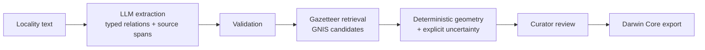

# LocalityLens

[](https://github.com/professor3333/LocalityLens/actions/workflows/ci.yml)

> Turn historical specimen locality descriptions into reviewable geographic records.

**Status: early development (Phase 1: data and feasibility).** Nothing here is ready to use yet.
This README describes only what exists; planned work is listed separately and labelled as such.



## The problem

Historical biodiversity specimens describe where they were collected in prose, for example
*"Larimer Co., Colo., 2 mi NE of Longs Peak summit."* To make these records usable for ecological
research, someone has to interpret abbreviations and relative descriptions, find the right
reference place, and work out a geographic region with an honest uncertainty. This is slow manual work.

LocalityLens is a review workbench for that task. A small local language model only *interprets
the text* (place mentions, distances, directions, qualifiers, and what is missing). Place lookup,
coordinates, and uncertainty are computed by ordinary, testable code from a pinned USGS GNIS
snapshot. A curator approves, corrects, or defers every proposal before anything is exported.
Ambiguous or unsupported descriptions get an explicit unresolved status, not a falsely
precise map pin.

The first release is scoped to English-language plant specimens collected in Colorado
(University of Colorado Herbarium, via GBIF). Existing tools such as
[GEOLocate](https://www.geo-locate.org/) already georeference records; LocalityLens is a
measured workflow for difficult relative descriptions and will be benchmarked against it.

## What exists today

- **Extraction contract** (`localitylens.extract.schema`): the typed output an extractor (LLM
  or rules) must produce. All evidence is given as *exact quotes* from the locality text.
  Extractors cannot supply character offsets, parsed numbers, or coordinates (unknown fields
  are rejected).
- **Deterministic validation** (`localitylens.extract.validate`): finds every quote in the text
  and maps it to a half-open `[start, end)` span of the *original* string. Code parses distance
  numbers (`2`, `2.5`, `1 1/2`, `½`). It also checks that quoted units and directions agree with
  the extractor's choices, refuses ambiguous units such as a bare `m`, and requires each relation's
  components to be present or explicitly declared missing.
- **Text normalization with offset map** (`localitylens.ingest.normalize`): NFC and whitespace
  collapsing. Every normalized character maps back to its exact original range.
- **Geography primitives** (`localitylens.geo`): exact unit conversion (2 mi = 3,218.688 m),
  16-point compass parsing, and geodesic forward/inverse calculations on the ellipsoid of each
  coordinate's datum (no silent WGS84 assumption).
- **Record lifecycle** (`localitylens.domain.status`): explicit statuses and a single
  transition function. A record can only reach `approved` through a pipeline outcome followed by
  curator review.
- **GNIS snapshot + manifest** (`localitylens.data`): downloads the USGS Colorado Domestic
  Names and national All Names files into an immutable, checksummed snapshot. A changed
  upstream file can never overwrite an existing snapshot.
- **Gazetteer index and search** (`localitylens.gazetteer`): a SQLite index of 26,429 features
  with official and 4,190 variant names (from the 2026-09-29 snapshot). Search runs exact,
  then variant, then fuzzy (RapidFuzz). County, state and feature type **rank** candidates but
  never filter them, and each candidate carries the evidence for its rank. A former name (for
  example "Mt. Evans", now Mount Blue Sky) competes equally with a current official name.
- Tests: unit tests plus Hypothesis property tests for span mapping, normalization, and geodesic
  round trips. Gazetteer tests use synthetic GNIS-format fixtures, so no network or real data is
  needed. CI runs lint, format, strict mypy, and tests on every push.

## Planned (not yet built)

Specimen snapshot (GBIF), 50-record data audit, rules baseline, LLM extraction via llama.cpp,
uncertainty policy and footprints, review UI, Darwin Core export, evaluation suite.

## Data

| Source | Snapshot | Licence / terms |
|---|---|---|
| USGS GNIS, Domestic Names (CO) + All Names (National) | `gnis-co-2026-09-29` (manifest: [`data/manifests/gnis-co-2026-09-29.json`](data/manifests/gnis-co-2026-09-29.json)) | U.S. public domain. *"Acknowledgment of the U.S. Geological Survey would be appreciated for products derived from these data."* |

Coordinates are NAD83 (GRS80). Raw files are not committed. The manifest records URLs,
SHA-256 hashes, sizes and publication dates, so the snapshot can be re-downloaded and verified.

Known GNIS limitations that affect georeferencing:
- Each feature lists only its **primary county**. Longs Peak is listed under Boulder County,
  though labels often say Larimer.
- A feature's coordinate is a single **representative point**. For streams it is the mouth
  (the Colorado River's is in Mexico), so it is not the collecting locality.
- Missing source coordinates are written as `0.0` in GNIS and are stored as null.
- Most cultural features (mines, ranches, post offices, other "locales") are **not** in
  Domestic Names, so labels that cite them return `feature_absent_from_index`.

## Development

Requires [uv](https://docs.astral.sh/uv/).

```bash
uv sync
uv run pytest
uv run ruff check . && uv run ruff format --check .
uv run mypy src/
HYPOTHESIS_PROFILE=thorough uv run pytest tests/property   # 5,000 examples per property
```

No network access is needed to run the tests.

Build the gazetteer from a real snapshot (downloads about 23 MB from USGS):

```bash
uv run localitylens data fetch-gnis                     # -> data/raw/gnis/<date>/ + manifest
uv run localitylens gazetteer build --snapshot data/raw/gnis/2026-09-29
uv run localitylens gazetteer search "Long's Pk." --county "Larimer Co." --type summit
```

## Licence

Code: MIT (see [LICENSE](LICENSE)). Data sources carry their own licences and attribution
requirements, which will be documented with each snapshot manifest.
