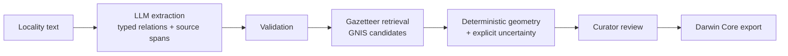

# LocalityLens

[](https://github.com/professor3333/LocalityLens/actions/workflows/ci.yml)

> Turn historical specimen locality descriptions into reviewable geographic records.

**Status: early development (Phase 1: data and feasibility).** Nothing here is ready to use yet.
This README describes only what exists; planned work is listed separately and labelled as such.



## The problem

Historical biodiversity specimens describe where they were collected in prose, for example
*"Larimer Co., Colo., 2 mi NE of Longs Peak summit."* To make these records usable for ecological
research, someone has to interpret abbreviations and relative descriptions, find the right
reference place, and work out a geographic region with an honest uncertainty. This is slow manual work.

LocalityLens is a review workbench for that task. A small local language model only *interprets
the text* (place mentions, distances, directions, qualifiers, and what is missing). Place lookup,
coordinates, and uncertainty are computed by ordinary, testable code from a pinned USGS GNIS
snapshot. A curator approves, corrects, or defers every proposal before anything is exported.
Ambiguous or unsupported descriptions get an explicit unresolved status, not a falsely
precise map pin.

The first release is scoped to English-language plant specimens collected in Colorado
(University of Colorado Herbarium, via GBIF). Existing tools such as
[GEOLocate](https://www.geo-locate.org/) already georeference records; LocalityLens is a
measured workflow for difficult relative descriptions and will be benchmarked against it.

## What exists today

- Project scaffold, packaging (`uv`), linting, type checking, tests, and CI.

## Planned (not yet built)

Data snapshots and manifests, GNIS gazetteer index, rules baseline, LLM extraction via llama.cpp,
geometry and uncertainty engine, review UI, Darwin Core export, evaluation suite.

## Development

Requires [uv](https://docs.astral.sh/uv/).

```bash
uv sync
uv run pytest
uv run ruff check . && uv run ruff format --check .
uv run mypy src/
```

## Licence

Code: MIT (see [LICENSE](LICENSE)). Data sources carry their own licences and attribution
requirements, which will be documented with each snapshot manifest.
