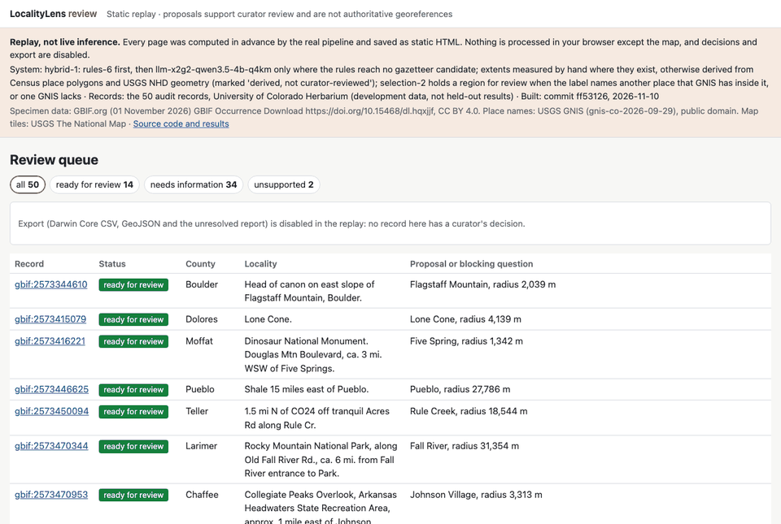

<p align="center">
  
</p>

<p align="center">
  <a href="https://github.com/professor3333/LocalityLens/actions/workflows/ci.yml"></a>
  
  <a href="https://github.com/astral-sh/uv"></a>
  <a href="https://github.com/astral-sh/ruff"></a>
  
  <a href="LICENSE"></a>
  <br>
  
  
  
  <a href="https://professor3333.github.io/LocalityLens/"></a>
</p>

<p align="center">
  <a href="#-how-it-works">How it works</a> ·
  <a href="#-try-it">Try it</a> ·
  <a href="https://professor3333.github.io/LocalityLens/">Replay demo</a> ·
  <a href="#-results">Results</a> ·
  <a href="#-limitations">Limitations</a> ·
  <a href="#-data--licences">Data</a> ·
  <a href="#-development">Development</a>
</p>

---

Natural history museums hold millions of specimens whose collecting locality exists only as prose
written by the collector, often a century ago:

> *Larimer Co., Colo., 2 mi NE of Longs Peak summit.*

Before ecologists can use such a record, someone has to read the abbreviations, find the right
reference place among many with similar names, apply the offset, and decide **how uncertain** the
result is. **LocalityLens** is a review workbench for that job. A small, local language model
*reads* the description. Ordinary, tested code finds the places and does the geometry. A
curator approves, corrects, or defers every result before it is exported as Darwin Core.

<p align="center">
  <a href="https://professor3333.github.io/LocalityLens/"></a>
  <br><sub>The real review screen, frozen as a <a href="https://professor3333.github.io/LocalityLens/">static replay</a> of the 50 audit records: the queue, a ready record with its region, and a record held back with a question.</sub>
</p>

> [!NOTE]
> **Release v0.1.3: a research prototype, not a production georeferencing service.**
> [Project summary](docs/summary.md) · [Results on one page](docs/results.md) ·
> [Definition-of-Done audit](docs/definition-of-done.md) · [User guide](docs/guide.md)

## 🧭 How it works

<p align="center">
  
</p>

| The language model does | Deterministic code does |
|---|---|
| Read abbreviations and varied phrasing (`Colo.`, `Pk.`, `nr.`) | Look up places in a pinned gazetteer snapshot |
| Pull out relations: *what* is offset from *where*, by how much, in which direction | Parse every number and unit, and convert units exactly |
| Separate what the label **says** from what is **missing** | Compute coordinates and geodesic offsets on the source datum |
| Say which ambiguity a curator needs to resolve | Validate, track provenance, enforce statuses, export |

**The model never produces a coordinate, an ID or a character offset.** It returns exact quotes,
and code locates them in the original text. A **rules baseline** fills the same contract and runs
first: the LLM is asked only when the rules reach no place (`hybrid-1`).

## ⚡ Try it

Python 3.12+ and [uv](https://github.com/astral-sh/uv); about 30 MB of data. The LLM adds
llama.cpp and a 2.74 GB model file.

```bash
git clone https://github.com/professor3333/LocalityLens.git && cd LocalityLens
uv sync
uv run localitylens data fetch-gnis        # pinned GNIS snapshot, checksummed
uv run localitylens gazetteer build        # SQLite index from that snapshot
```

```console
$ uv run localitylens baseline run --limit 2 \
      "Larimer Co., Colo., 2 mi NE of Longs Peak summit."
extractor   rules-6
relation    distance_and_direction
quote       "2 mi NE of Longs Peak summit" [20:48]
feature     Longs Peak [31:41] type=summit
distance    2 mile [20:21]
direction   NE [25:27]
admin       county "Larimer Co." · state "Colo."
missing     none
retrieval   candidates_found (county context: Larimer Co., from text)
  1.  204979  Longs Peak                 Summit          Boulder      exact_official  type=y county=n
  2.  186722  Youngs Peak                Summit          Delta        fuzzy_official  type=y county=n
```

```bash
uv run localitylens review import --csv my_records.csv --extents data/reviewed/extents.csv
uv run localitylens review serve           # the map review screen on http://127.0.0.1:8000/
uv run localitylens review export          # approved records as Darwin Core CSV + GeoJSON
```

The [user guide](docs/guide.md) covers the rest, each with real output: the local LLM,
uncertainty proposals, extents, the review screen and API, CSV mapping, jobs and traces, gazetteer
search and Docker Compose. [Deployment](docs/deployment.md) covers backup, upgrade and rollback.

## 📊 Results

Correct proposal candidates on the **locked test** (owner-annotated, 56 answerable, each run
declared before it ran):

| | Rules | LLM alone | **hybrid-1** |
|---|---|---|---|
| Release 3 (current rules) | 22 (39%) | 18 (32%) | **28 (50%)**: +10.7 points, CI +3.6 to +19.6 |

- **The +10-point target is met by the smallest possible margin.** The LLM alone doesn't beat
  the rules.
- **Precision of ready regions is far from target:** 55–66% on read data, against 95%. The main
  error is a label naming a specific place while the system uses the offset town
  ([results](docs/results.md), [evaluation](docs/evaluation.md)).
- **The selection check holds back mostly wrong regions:** 53 wrong vs 13 correct over three
  declared checks. It is on by default.
- **Reproducible:** a fresh clone reruns 160 records identically. Every tag is re-evaluated, and
  the deployment checked on Linux ([audit](docs/definition-of-done.md)).

## 🛡️ Design guarantees

| Guarantee | How | |
|---|---|:-:|
| **The LLM never produces coordinates** | No coordinate field in its schema; coordinates in free text are refused; geometry is code | ✅ |
| **Every claim cites the label** | Quotes are located and mapped to `[start, end)` spans of the original text | ✅ |
| **Unknown uncertainty is never zero** | Without an extent the radius stays unknown, and the record asks for it | ✅ |
| **Abstain rather than guess** | Missing units, routes and absent places become questions or `unsupported`, never a guess | ✅ |
| **Humans approve before export** | One checked status machine; only `approved` records are exported | ✅ |
| **A crash never strands a record** | Leased jobs in SQLite transactions; expired leases return records to the queue | ✅ |
| **No answer leakage** | The model sees only label text and admin fields; no record's coordinates are ever read | ✅ |

The full list, and the cited uncertainty policy, are in the [user guide](docs/guide.md#design-guarantees).

## ⚠️ Limitations

- **One herbarium, Colorado, English:** nothing is claimed beyond what was measured.
- **Thin margins:** one locked-test record is 1.8 points.
- **GNIS is current, labels are historical.** Old names and vanished places may be missing.
- **GNIS gives points, not shapes:** regions need a measured or derived extent.
- **Not measured:** reviewer time (needs human reviewers), and containment with region size.
- **No proposal ≠ unlocatable:** `needs_information` means this release could not propose a
  region.

## 🗺️ Roadmap

| Phase | Highlights | Status |
|---|---|---|
| **1 · Data & feasibility** | GNIS gazetteer · rules baseline · cited uncertainty policy · 50-record audit | ✅ |
| **2 · MVP** | Local LLM extraction · extents (hand-measured + derived) · map review screen · Darwin Core CSV + GeoJSON | ✅ |
| **3 · Production engineering** | Persistent jobs · traces · JSON API · OpenTelemetry · Docker Compose | ✅ |
| **4 · Evaluation** | Three locked-test releases · fresh declared tests · ablations · 2B vs 4B · GEOLocate · quantization parity | ✅ (reviewer pilot not run) |
| **5 · Release** | Replay demo · backup and rollback · release workflow · audit · mirrored data · [v0.1.3](https://github.com/professor3333/LocalityLens/releases/tag/v0.1.3) | ✅ |

The full development story is in [history](docs/history.md); what's next is in the
[summary](docs/summary.md#where-to-pick-up).

## 📚 Data & licences

| Source | Snapshot | Terms |
|---|---|---|
| **USGS GNIS** | [`gnis-co-2026-09-29`](data/manifests/gnis-co-2026-09-29.json): 26,429 features | U.S. public domain |
| **University of Colorado Herbarium** via GBIF | [`gbif-cu-2026-11-01`](data/manifests/gbif-cu-2026-11-01.json): 311,988 records · DOI [10.15468/dl.hqxjjf](https://doi.org/10.15468/dl.hqxjjf) | CC BY 4.0 |
| **USGS NHD** and **Census TIGER** (derived extents) | [`nhd-co-2023-12-27`](data/manifests/nhd-co-2023-12-27.json) · [`tiger-place-co-2025`](data/manifests/tiger-place-co-2025.json) | Public domain · not copyrighted |
| **Qwen3.5-4B** (Qwen), GGUF by unsloth | [`release/manifest.json`](release/manifest.json): Q4_K_M, sha256 `00fe7986…` | Apache-2.0 |

Raw files are never committed: each manifest pins URLs and SHA-256 hashes, and every snapshot is
mirrored unchanged in this repository's data releases. See the
[dataset card](docs/dataset_card.md) and [model card](docs/model_card.md).

## 🛠️ Development

```bash
uv sync --all-extras                                        # install, as CI does
uv run pytest                                               # all tests, no network needed
uv run ruff check . && uv run ruff format --check .         # lint + format
uv run mypy src/                                            # strict type check
```

CI runs these, a llama.cpp smoke test and a browser test of the review flow on every push. Each
version tag re-evaluates the real model on the dev and validation data against the declared gates
in [`release/regression.json`](release/regression.json), and checks the deployment on Linux
([releasing](docs/deployment.md#releasing)).

<details>
<summary><b>Project structure</b></summary>

```text
src/localitylens/   domain · extract · ingest · geo · data · gazetteer · baseline · resolve ·
                    pipeline · evaluation · review · jobs · telemetry · export · web · cli.py
tests/              unit · e2e · adversarial · property
data/               snapshot manifests, measured and derived extents (raw data gitignored)
release/            pinned release manifest, Q8_0 reference, regression gates
eval/               audit, dev samples, benchmark (validation + locked test), reports
demo/site/          the static replay on GitHub Pages
docs/               summary, results, evaluation, guide, deployment, cards, history
```

Module by module: [user guide](docs/guide.md#modules).

</details>

## 📄 Licence & acknowledgements

Code: [MIT licence](LICENSE). Geographic names courtesy of the **U.S. Geological Survey** (GNIS);
derived extents use USGS NHD and **U.S. Census Bureau** TIGER/Line data. Methodology follows the
[GBIF Georeferencing Best Practices](https://docs.gbif.org/georeferencing-best-practices/1.0/en/).
[GEOLocate](https://www.geo-locate.org/) is the established tool in this space; LocalityLens was
compared with it on read samples only ([findings](eval/reports/geolocate-findings.md)).
